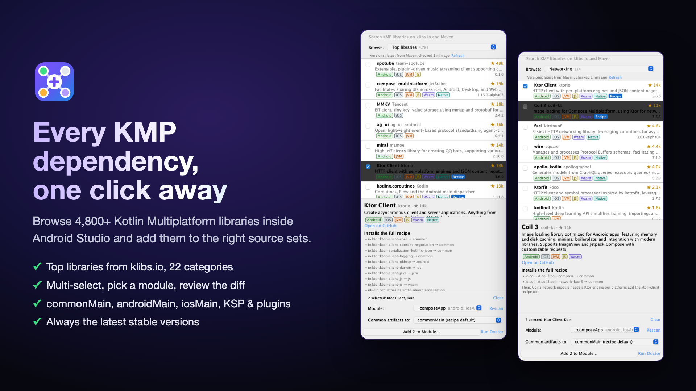

# KMP Dependency Hub

[](https://github.com/KhubaibKhan4/kmp-dependency-hub/actions/workflows/build.yml)
[](LICENSE)
[](https://plugins.jetbrains.com/plugin/35177)



Add Kotlin Multiplatform, Compose Multiplatform and Android libraries to the right place in one step,
from the IDE or from `./gradlew`.

A recipe knows that Ktor needs `ktor-client-core` in `commonMain`, OkHttp in `androidMain`, Darwin in `iosMain`
and the serialization plugin; that Room needs KSP per target plus two Gradle plugins; that Hilt is Android-only.
The hub writes the version catalog entries, source-set dependencies and plugins, and refuses to put a library
in `commonMain` when it doesn't publish for every target the module compiles for.

## Modules

| Module | What it is |
|---|---|
| `core` | Dependency-free engine: catalog, recipes, `libs.versions.toml` and `build.gradle.kts` editors, installer, doctor, diff. |
| `gradle-plugin` | `io.github.kmphub`, applied to the root project. Reads the real Kotlin model (targets) from Gradle. |
| `idea-plugin` | Tool window for Android Studio / IntelliJ: search, multi-select, pick a module and source set, review the diff, apply (one undo). |
| `tools/` | `refresh_catalog_versions.py` bumps every recipe to the latest stable release on Maven Central / Google Maven / Plugin Portal. |

The curated data lives in [`core/src/main/resources/kmphub/catalog.json`](core/src/main/resources/kmphub/catalog.json).

Publishing to JetBrains Marketplace and the Gradle Plugin Portal: see [PUBLISHING.md](PUBLISHING.md). Privacy: [PRIVACY.md](PRIVACY.md) — no telemetry.

## Install in Android Studio

1. Download the zip from [Releases](https://github.com/KhubaibKhan4/kmp-dependency-hub/releases), or build it: `./gradlew :idea-plugin:buildPlugin`.
2. Android Studio → **Settings → Plugins → ⚙ → Install Plugin from Disk…** → pick the zip → **Restart IDE**.
3. Open the **KMP Hub** tool window on the right.

Works in Android Studio and IntelliJ IDEA 2025.1 or newer (`since-build` 251, no upper bound).

## Browsing

- **Top libraries**: the most-starred of klibs.io's ~4,800 KMP projects, 50 at a time; more load as you scroll.
- **Browse ▾**: 22 categories (Networking, Database, DI, Navigation, Images, …) backed by klibs.io tags, 20 at a time,
  with live project counts. **Recipes** lists the curated recipes, including Android-only ones like Hilt.
- Ticking a project selects its most likely artifact; the details pane lists every artifact to pick others.
  Projects with a curated recipe (Ktor, Koin, Room, SQLDelight, Coil, …) install the full recipe instead.
- Searching covers klibs.io first, then raw Maven Central / Google Maven hits once klibs.io results run out.

## Always-current libraries

- **Latest versions.** Every curated recipe resolves its newest stable release from Maven Central, Google Maven
  and the Gradle Plugin Portal: when the tool window opens (or on **Refresh**), and in every Gradle task.
  Results are cached for 24 h (`<IDE system dir>/kmphub/versions.json`, `~/.gradle/kmphub/versions.json`).
  Pre-releases and `-compat` builds are skipped. Offline, the cache (then the bundled catalog) is used.
- **Any library, as soon as it's published.** Typing 3+ characters also searches Maven Central and Google Maven.
  Each hit's platforms come from its Gradle module metadata (`.module`), falling back to the POM packaging, so the
  commonMain safety check works for libraries the hub has never seen.

Curated recipes still matter: they know the per-platform engines, BOMs, KSP processors, plugins and config
blocks that a single search hit can't express.

## Gradle usage

In the project you want to manage, point Gradle at this build and apply the plugin to the root:

```kotlin
// settings.gradle.kts
pluginManagement {
    includeBuild("../kmp-dependency-hub")
}
```

```kotlin
// build.gradle.kts (root)
plugins {
    id("io.github.khubaibkhan4")
}
```

```bash
./gradlew kmpHubList --category=Networking
./gradlew kmpHubSearch --query=okio
./gradlew kmpHubModules
./gradlew kmpHubAdd --lib=ktor-client,koin,room --module=:composeApp --preview
./gradlew kmpHubAdd --lib=ktor-client,koin,room --module=:composeApp
./gradlew kmpHubAdd --lib=retrofit --module=:composeApp --source-set=androidMain
./gradlew kmpHubAdd --lib=com.squareup.okio:okio      # any group:name from kmpHubSearch
./gradlew kmpHubDoctor --strict
```

`--preview` prints the unified diff without writing (Gradle reserves `--dry-run`). `--force` installs even when a
library doesn't support every target. `--refresh` skips the 24 h version cache, and Gradle's `--offline` is
respected. `kmpHubDoctor --strict` fails the build on errors, for CI.

## IDE usage

```bash
./gradlew :idea-plugin:runIde
```

This launches a sandbox Android Studio (the install set by `kmphub.ideaLocalPath` in `local.properties`) with the
**KMP Hub** tool window on the right and **Tools → KMP Hub: Run Doctor**. `./gradlew :idea-plugin:buildPlugin`
produces an installable zip in `idea-plugin/build/distributions/`.

## Development

Builds with the JDK bundled in Android Studio (Java 25). Point the build at your IDE in the git-ignored
`local.properties`: `kmphub.ideaLocalPath=/Applications/Android Studio.app`.

```bash
export JAVA_HOME="$HOME/Applications/Android Studio.app/Contents/jbr/Contents/Home"
./gradlew build                          # everything, including TestKit tests that compile a real KMP module
./gradlew build -Pkmphub.skipIdea=true   # engine + Gradle plugin only
python3 tools/refresh_catalog_versions.py
```

Compatibility targets: the Gradle plugin and engine compile to Java 17 / Kotlin API 2.1; the IDE plugin to Java 21,
`since-build` 251 (2025.1), and is built against Android Studio 2026.2.

## Roadmap

- Standalone CLI jar on top of `core`: Gradle tasks can't run when the build fails to configure (e.g. a plugin
  missing required setup), while the engine itself only needs the files. The IDE tool window already works that way.
- Split the Koin recipe into core and a Compose add-on, so non-Compose modules don't get `koin-compose`.
- Upgrade solver: pick a compatible set (Kotlin, KSP, Compose Multiplatform, libraries) and apply it as one change.
- klibs.io as an extra search source, with descriptions and GitHub stars.
- Publish recipes as a remote JSON feed, so new curated recipes arrive without a plugin update.
- Read source sets and targets from the IDE's Gradle sync model instead of scanning build files.
- More recipes, and "feature" recipes that also generate glue code (HttpClient setup, Koin modules).
- Groovy `build.gradle` and convention-plugin (`build-logic`) projects.
